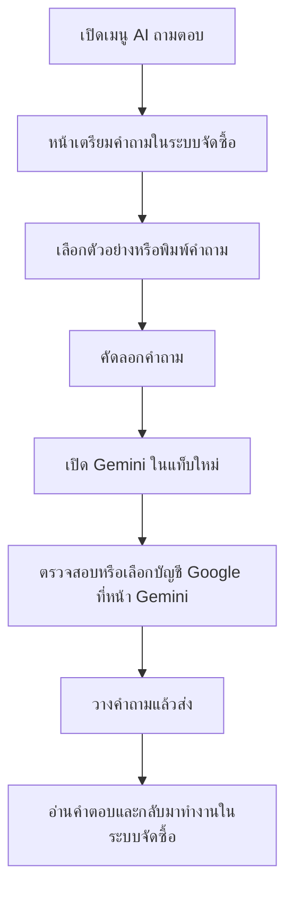

# โฟลว์ AI ถามตอบด้วยบัญชี Google

หน้าเมนูเดิมเรียก `/supplies/ai/index.html` ซึ่งเดิมไม่มีไฟล์ ทำให้ขึ้น 404
เพิ่มหน้าเตรียมคำถามที่เส้นทางเดิม โดยไม่เปลี่ยนเมนูหรือแท็บของระบบ

- ปุ่มเปิด Gemini ใช้ HTTPS และ `noopener noreferrer`
- Gemini ตอบกลับ header `X-Frame-Options: DENY` จึงเปิดเป็นแท็บใหม่ ไม่ฝัง iframe ของ Gemini
- ระบบไม่อ่าน Chrome profile, Google cookies หรือรหัสผ่าน และไม่สมมติว่าบัญชี Google ตรงกับผู้ใช้ ERP
- ไม่ส่งคำถามอัตโนมัติ ไม่เก็บข้อความใน localStorage หรือฐานข้อมูล
- หากคัดลอกผ่าน Clipboard API ไม่ได้ จะเลือกข้อความให้คัดลอกด้วยตนเอง
- รองรับบัญชี Google ที่ผู้ใช้เลือกใน Gemini การให้สิทธิ์บัญชีหน่วยงานขึ้นกับ Google Workspace ของหน่วยงาน
- ไม่มีการเรียก Gemini API และไม่ต้องตั้งค่า API key สำหรับโฟลว์นี้

อ้างอิง: https://support.google.com/gemini/answer/13278668?hl=th
