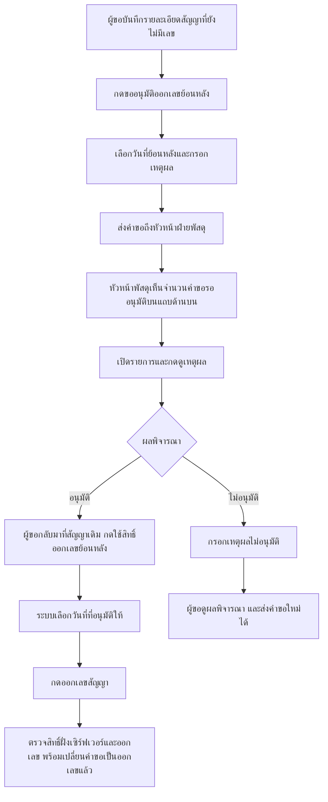

# คำขออนุมัติออกเลขสัญญาย้อนหลัง

## ผู้รับคำขอ

ภูริวัชร์ เชาว์โรจนนนท์ บัญชี `phuriwach` (user ID 30047 ในฐานข้อมูลพัฒนา NMU_ERP)
สายงานหัวหน้าฝ่าย หน่วยงานฝ่ายพัสดุ ตรวจสอบจากฐานข้อมูลวันที่ 19 ตุลาคม 2569
ระบบค้นหาจากชื่อบัญชี สายงาน และหน่วยงานที่เปิดใช้งาน ไม่รับผู้อนุมัติจากค่าที่ผู้ขอส่งมา

## โฟลว์



## ตำแหน่งหน้าจอ

- แถบด้านบน: ปุ่มคำขอออกเลขย้อนหลัง สำหรับผู้ขอ และคำขอย้อนหลังรออนุมัติสำหรับหัวหน้าพัสดุ
- หน้าลงนามในสัญญา: แทนปุ่มปลดล็อกเดิมด้วยปุ่มขออนุมัติ / ใช้สิทธิ์ออกเลขสัญญาย้อนหลัง และปุ่มดูคำขอ / เหตุผล / ผลพิจารณา
- เปิดรายการคำขอ เลือกแถวแล้วกดดูเหตุผล / พิจารณา หรือดับเบิลคลิกแถว
- หัวหน้าพัสดุเห็นปุ่มอนุมัติและไม่อนุมัติเฉพาะคำขอที่ยังรอพิจารณา
- จำนวนรอพิจารณารีเฟรชทุก 30 วินาที ผู้ขอเปิดรายการเพื่อดูผลอนุมัติหรือไม่อนุมัติ

## เงื่อนไข

- ผู้สร้างสัญญาต้องบันทึกสัญญาก่อนส่งคำขอ
- ระบุวันที่ก่อนวันปัจจุบันตามเวลาไทยและเหตุผลไม่เกิน 2,000 ตัวอักษร
- ไม่รับคำขอซ้ำหากสัญญามีคำขอรอพิจารณาหรืออนุมัติแล้ว
- ผู้ขอเห็นเฉพาะคำขอของตน ผู้อนุมัติเห็นเฉพาะคำขอที่ส่งถึงตน
- สิทธิ์อนุมัติผูกกับผู้ขอ สัญญา รายการ TOR และวันที่ที่ระบุ ใช้ได้ครั้งเดียว
- การออกเลขและใช้สิทธิ์อนุมัติอยู่ใน transaction เดียวกัน หากออกเลขไม่สำเร็จจะ rollback
- กรณีไม่อนุมัติต้องระบุเหตุผล และเก็บประวัติคำขอเดิมไว้
- การอนุมัติไม่ออกเลขสัญญาให้อัตโนมัติ ผู้ขอต้องกลับไปกดออกเลข

## การติดตั้งและตรวจสอบ

ติดตั้ง migration `database/migrations/20261019_contract_backdate_request.sql` ในฐานข้อมูลเดียวกับ supplies
รันซ้ำได้ ติดตั้งแล้วในฐานข้อมูลพัฒนาเครื่องนี้ ยังไม่ได้ติดตั้งในฐานข้อมูล production

ตรวจสอบ:

```text
php -n tests/backdate-request-test.php
php -n tests/backdate-contract-test.php
```

ยังต้องทดสอบหน้าจอจริงด้วยบัญชีผู้ขอและบัญชีหัวหน้าพัสดุ
